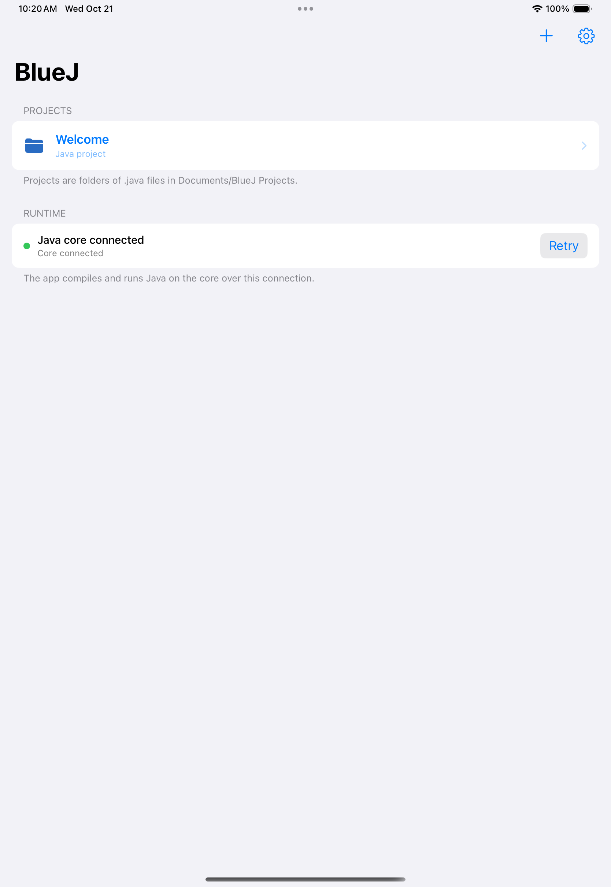
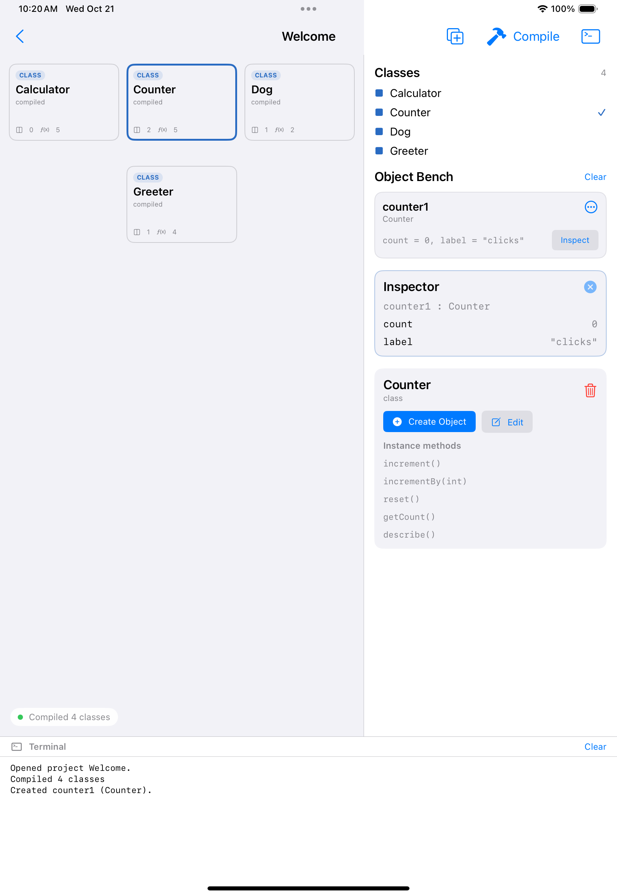
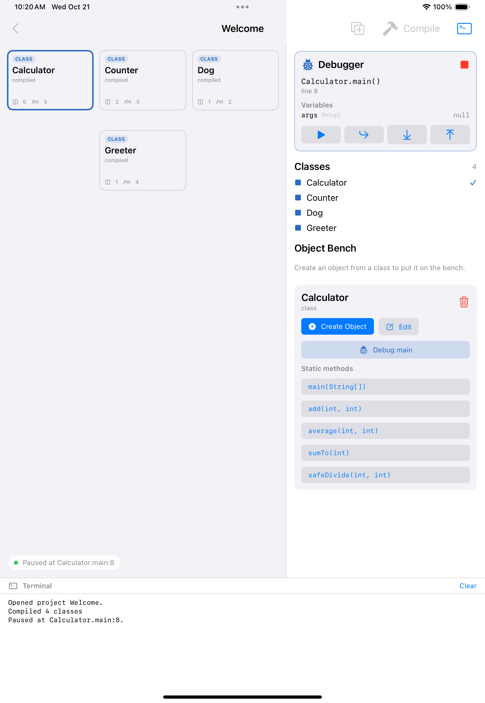

# The BlueJ iPad app

A native SwiftUI IDE that compiles and runs real Java through the project's Java core. It is
not a mock-up: the class diagram, editor, object bench, inspector and terminal are all driven
by `javac` and the interpreter in `spike-java/`.

```
┌──────────────────────────── iPad (SwiftUI) ────────────────────────────┐
│  Project browser → class diagram → editor → bench → inspector → log     │
│                            BlueJPadKit                                  │
│   JSONValue · CoreAPI · Workspace · ProjectStore · ClassDiagramLayout   │
└───────────────────────────────┬────────────────────────────────────────┘
                                │ one JSON request / one response
                    HTTPCoreClient (simulator, Mac, Wi-Fi)
                                │
┌───────────────────────────────┴────────────────────────────────────────┐
│  core-server (JDK 21)                                                   │
│   CoreProtocol → CoreSession → ProjectCompiler (javac) + Interpreter    │
└────────────────────────────────────────────────────────────────────────┘
```

The protocol is transport-independent on purpose: the device build swaps `HTTPCoreClient`
for an in-process bridge that returns the same JSON, and no UI or model code changes.

## What the app does

- **Projects** are folders of `.java` files in `Documents/BlueJ Projects`, with a small
  `project.json`. Create, open and delete them from the browser; the sample *Welcome* project
  is created on first launch.
- **Class diagram** lays classes out by inheritance depth, draws `extends` arrows, stripes
  classes that have not compiled, and marks erroneous classes. Tap to select, double-tap (or
  Edit) to open the source.
- **Editor** with Java syntax colouring, Save, and the compile diagnostics for that file.
- **Compile** sends every source to the core, runs `javac` in memory, reports diagnostics with
  file/line/column, and redraws the diagram.
- **Object bench** constructs instances (constructor arguments included), names them the BlueJ
  way (`counter1`, `counter2`), calls instance methods with a parameter dialog, and removes
  them. Static methods are callable from the selected class.
- **Inspector** shows instance fields in declaration order, with expandable objects and arrays.
- **Debugger** runs a class's `main` under a real debugger: set breakpoints (select a line in the
  editor and choose *Toggle Breakpoint*, or tap a chip to remove one), then press **Debug main**
  on the class detail card. The program pauses at the first breakpoint, or at the first line of
  `main` when there is none, and the sidebar shows the current frame, its locals and fields, and
  the caller stack. Continue, Step Over, Step Into, Step Out and Stop act on the paused program;
  compiling and editing are disabled while it is paused.
- **Terminal** shows `System.out` output, method return values, and runtime exceptions with
  their Java class (`java.lang.ArithmeticException: / by zero`). Unsupported bytecode is
  reported as "not supported on iPad yet" rather than as a student error.

## Running it

Requirements: JDK 21, Maven, Xcode 16, [XcodeGen](https://github.com/yonaskolb/XcodeGen).

```bash
# 1. Build the core (from the repository root)
mvn -f spike-java/pom.xml install -DskipTests
mvn -f core-server/pom.xml package -DskipTests

# 2. Serve the core on loopback
java -jar core-server/target/core-server-0.1.0-SNAPSHOT.jar --port 8899

# 3. Generate and open the Xcode project
cd app
xcodegen generate
open BlueJPad.xcodeproj
```

Run on an iPad simulator: the app defaults to `http://127.0.0.1:8899`.

Run on a real iPad (unsigned builds must be re-signed first, e.g. with SideStore): start the
core on a Mac that the iPad can reach, then enter that address under the gear button →
**Java Core** → `192.168.1.20:8899`. The environment variable `BLUEJ_CORE_URL` overrides the
saved address and is what CI and the UI tests use.

The app cannot compile Java on the device by itself yet: an iPad has no JVM, so the core must
run on a host. The roadmap entry for that is the in-process GraalVM bridge below.

## Tests

```bash
# Java core: compiler, protocol, server, interpreter, inheritance
mvn -f spike-java/pom.xml test
mvn -f core-server/pom.xml test

# Swift model, JSON codec, layout, highlighter, project store, workspace flows
cd app/BlueJPadKit && swift test

# Simulator UI tests against the real core (CI: .github/workflows/ios-app.yml)
xcodebuild test -project app/BlueJPad.xcodeproj -scheme BlueJPad \
  -destination 'platform=iOS Simulator,name=iPad Pro 13-inch (M4)'
```

The UI tests open the Welcome project, compile it, create a `Counter`, inspect it, call
`increment()` and `incrementBy(5)`, debug `Calculator.main` through a pause, a step and a finish,
create a `Dog` class, edit it and save — with a screenshot attached at each step.

## Screenshots from the CI run

Captured by the simulator UI tests against the real core, so they show the app as it is
built, not a mock-up.

| Project browser | Object bench and inspector | Paused in the debugger |
| --- | --- | --- |
|  |  |  |

## Debugging

`DebugSession` in the core keeps the interpreter's own thread parked on a breakpoint, so the
paused program needs no continuations: the thread simply stays where it is, and the next command
wakes it. Breakpoints are keyed `binary.ClassName#line`; the interpreter reports one callback per
executed source line, which is also what makes stepping land on lines rather than instructions.

```
{"op":"debugBreakpoints","points":["Calculator#7"]}
{"op":"debugStart","class":"Calculator","method":"main"}   → {status:"paused", frames:[…]}
{"op":"debugCommand","action":"stepOver"}                  → {status:"paused", frames:[…]}
{"op":"debugCommand","action":"continue"}                  → {status:"finished", output:…}
```

## Deliberate limits

- The debugger only pauses on lines and breakpoints: no conditional breakpoints, watch
  expressions or object-bench debugging yet.
- No JUnit integration and no `Scanner`/stdin in the terminal.
- Threads, synchronization, interfaces/default methods and most of the JDK are unsupported and
  fail explicitly.
- The runtime covers `int`, `long`, `float` and `double` with Java's widening conversions,
  including arrays of every primitive and `Math`/`Long`/`Float` helpers. Values keep their
  declared width end to end, so `println` and the inspector format them as Java does.
- The bench is session state: it is cleared on compile and when the project is reopened.
- The device build needs either the in-process bridge or a reachable core; there is no
  on-device JVM.
