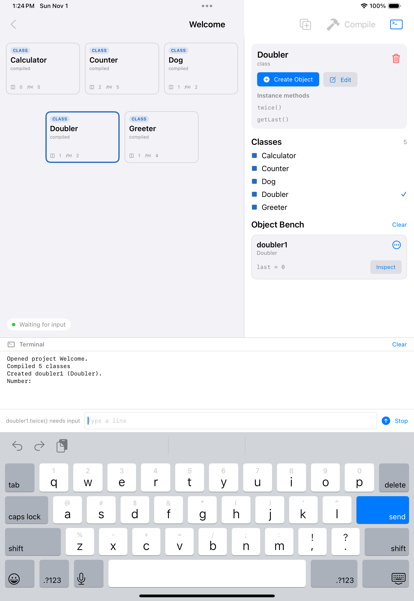
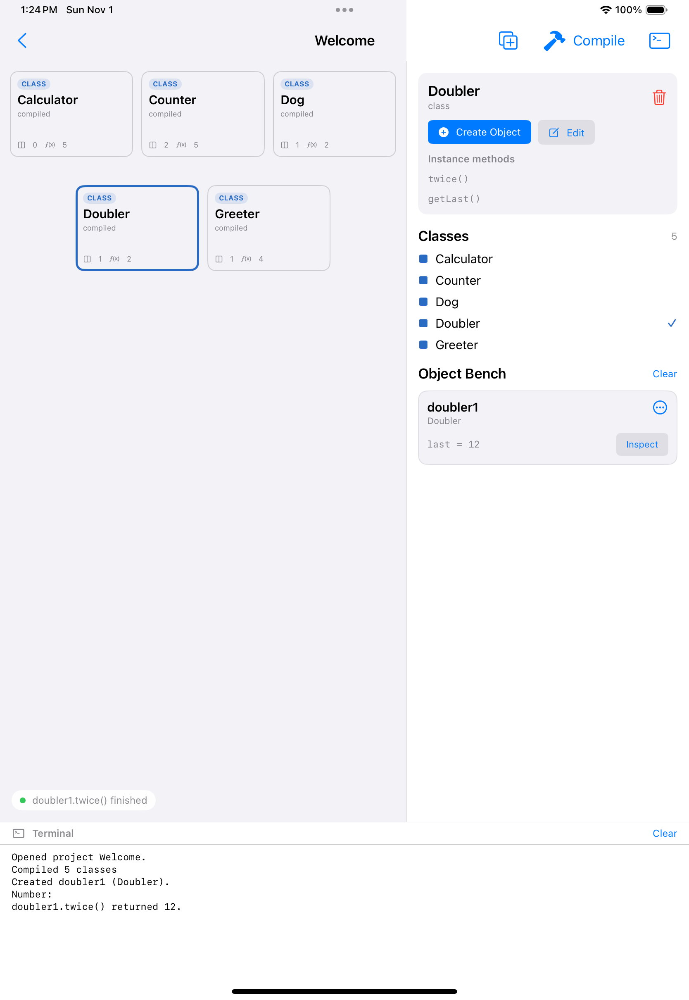

# Terminal input (`Scanner`) — 2026-11-01

`System.in` is a line queue owned by `CoreSession`. A bench call that reaches a read parks on
its own thread and the protocol answers `needsInput` instead of a value:

```
{"op":"invoke","handle":1,"method":"twice"}   → {"status":"needsInput","output":"Number: "}
{"op":"stdin","text":"21"}                    → {"value":{"int":42}}
{"op":"cancel"}                               → {"cancelled":true}   (unwinds a parked call)
```

## Tests

Java, `spike-java` (64/64 green locally):

- `InterpreterTest.scannerReadsTokensLinesAndNumbersFromStandardInput` — `nextInt`, `next`,
  `nextLine` (including the leading space Java leaves), `nextDouble`, `hasNextInt`, and a
  literal `new Scanner("7 8")`.
- `InterpreterTest.scannerReportsEndOfInputLikeJava` — empty input throws
  `java.util.NoSuchElementException`.
- `InterpreterTest.scannerProgramsPrintTheirPromptBeforeReading` — `print("Number: ")` is in
  the output before the read.
- `CoreSessionTest.aCallThatReadsInputWaitsForTheTerminal` — invocation returns
  `needsInput`, the prompt is visible, `compile`/`create` are refused, and `stdin` resumes it.
- `CoreSessionTest.eachReadParksAgainUntilTheProgramFinishes` — two reads need two lines.
- `CoreSessionTest.cancellingAWaitingCallMakesTheSessionUsableAgain` — cancel unwinds the
  thread and a new call runs.
- `CoreSessionTest.inputDuringADebugRunFailsInsteadOfHanging` — the debugger reports a
  failure rather than blocking forever.
- `CoreProtocolTest.pausesForTerminalInputAndResumesWithStdin` and
  `cancelsAPausedCallAndAcceptsTheNextOne` — the exact JSON shapes above.
- `CoreServerTest.pausesForTerminalInputOverHttp` — the same flow through the HTTP server.
- `AppFlowUITests.testTerminalInputFeedsAScannerProgram` — the iPad simulator creates a
  `Doubler`, calls `twice()`, types `6` into the terminal field and sees
  `doubler1.twice() returned 12.` (CI).

| Waiting for input | After sending 6 |
| --- | --- |
|  |  |

Captured by the simulator UI test against the real core, so the screenshots show the app
as built: the status chip says "Waiting for input", the field is labelled
`doubler1.twice() needs input`, and the bench's `last` becomes 12 once the line is sent.

## Limits

- One line per request; `System.in.read()`, `BufferedReader` and file redirection are not
  implemented.
- A constructor that reads input is refused, because `new` is not a parked call.
- Reading input while the debugger is paused is refused explicitly; the debug loop would need
  to return `needsInput` too.
